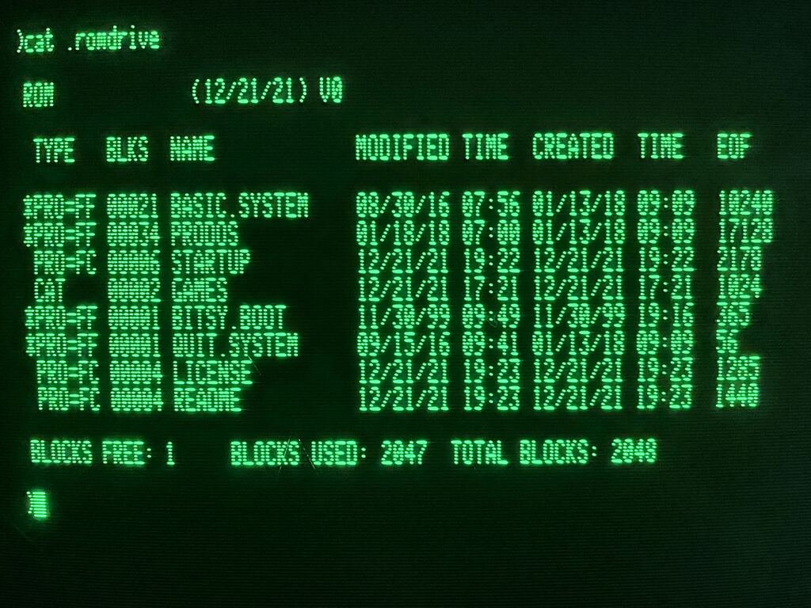

## Introduction

The [ROM-Drive](https://github.com/tjboldt/ProDOS-ROM-Drive) is a 1MB ROM interface card designed for the Apple II computer by Terence J. Boldt.  This project is the driver required for the Apple /// to recognize and use that card.

## Driver highlights:

* The ProDOS filesystem on the ROM-Drive is a descendant of SOS, and is supported for read operations.
* The ROM-Drive is read-only (as its name suggests), so writing or formatting is not supported.

## Building

Building requires a python interpreter in order to do the System Configuration Program (SCP) duties as delivered from Rob Justice's [a3driverutil project](https://github.com/robjustice/a3driverutil) and [ca65](https://github.com/cc65/cc65) in order to do the assembling and linking.

## Screenshot

## Video 

<video src="https://github.com/user-attachments/assets/6cd5837a-621a-403b-bbdc-dd1310ba419b" controls="controls" muted="muted" style="max-width: 100%;">
</video>
